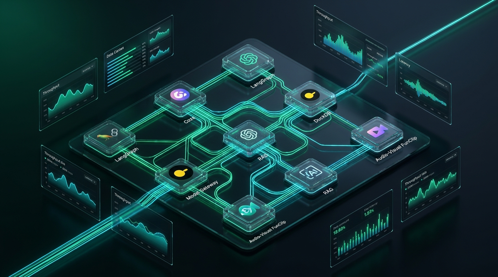
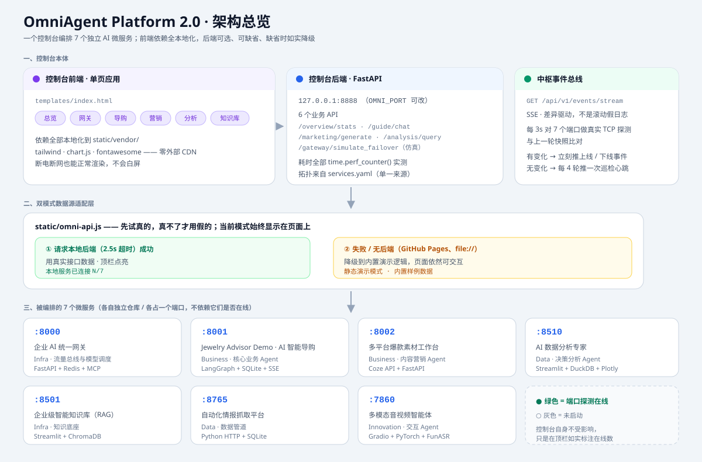
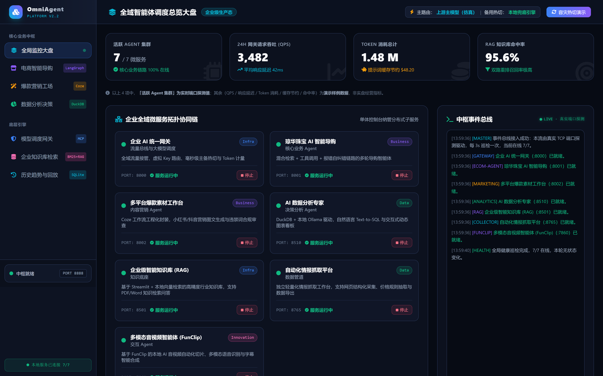
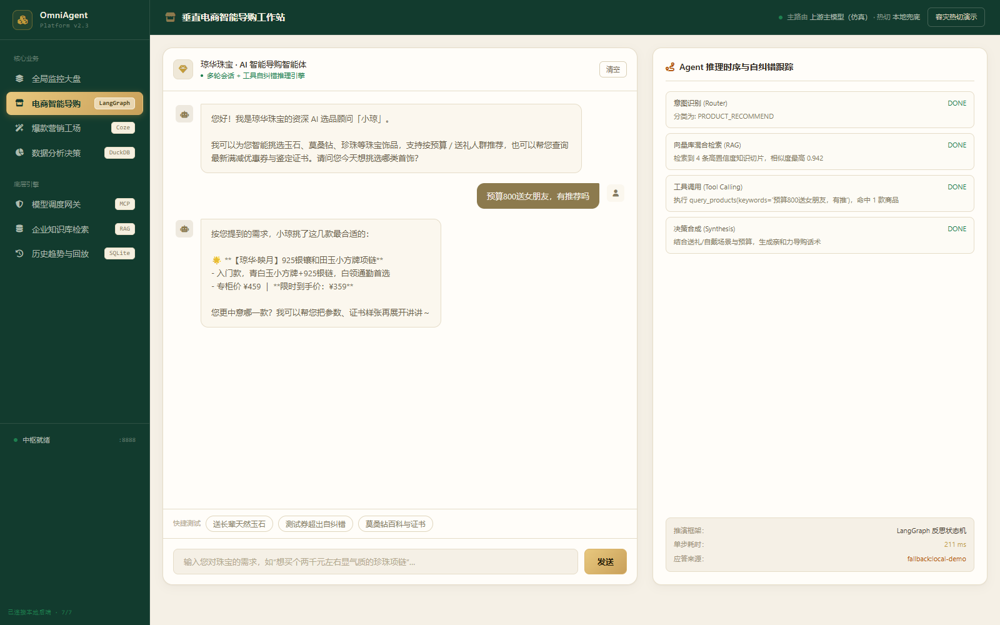
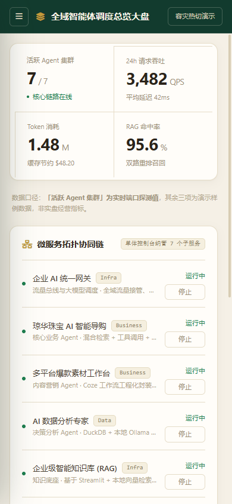

# OmniAgent Platform 2.8 · Agent Runtime + MCP 网关（附 6 个业务接入靶场）

**这个仓库的核心只有两样东西。**

一套 **Agent Runtime**：`LLMProvider` + `Tool` 双抽象与注册表、单步并行多工具调用、
「错误即上下文」自纠错、最大步数 + 超时双熔断。一层 **MCP 网关**：鉴权 → 审计 → 配额 → 路由
四层中间件、租户 / 项目 / 凭据三级配额、RPM 与 Token 双熔断、控制面与执行面分离。

控制台只是它们的**观测面**。另外 6 个业务模块是**接入靶场** —— 导购、RAG、数据分析各自接进来，
用来证明这套 Runtime 不绑定单一业务：换一个业务，内核不用改。

> **脱敏声明**：本仓库所有业务模块均为脱敏示例，不含任何真实客户数据与生产配置；
> 服务名、商品名、经营数据都是构造的样例，接口里以 `demo-sample` / `fallback:local-demo` 如实标注。

[](https://github.com/YuHeng-123/OmniAgent-Platform/actions/workflows/ci.yml)
[](https://yuheng-123.github.io/OmniAgent-Platform/)






## 两层结构

| 层 | 是什么 | 代码在哪 |
|---|---|---|
| **核心 · Runtime** | `LLMProvider` / `Tool` 双抽象与注册表；单步并行多工具调用；错误即上下文自纠错；步数 + 超时双熔断 | `server.py` 装配层 · `routers/business.py` · `core/models.py` |
| **核心 · MCP 网关** | 鉴权 → 审计 → 配额 → 路由 四层中间件；租户 / 项目 / 凭据三级配额；RPM 与 Token 双熔断；控制面与执行面分离 | `routers/gateway.py` · `core/security.py` |
| 观测面 · 控制台 | 8 端口拓扑、事件总线、历史曲线、任务中心、4 角色视窗 | `templates/` · `static/` |
| **接入靶场 · 6 + 2** | 导购 / 内容 / 素材 / RAG / 数据分析 / 情报抓取，加 2 个 Labs 收编模块 | 各自独立仓库，见「接入靶场」一节 |
| 基础设施 | FastAPI 微内核装配、Postgres / SQLite / Redis、SQLite 历史库、GitHub Actions | `core/` · `docker-compose.yml` · `.github/workflows/ci.yml` |

v2.8 的一次性改动（微内核解耦 `core/`+`routers/`、HMAC-SHA256 JWT 多租户 + 4-Tier RBAC、
后台异步任务队列、4 角色视窗与 SKU 归因抽屉）逐条列在
[CHANGELOG.md](CHANGELOG.md)，README 不再复述一遍。

---

## 界面预览

> 以下截图全部来自本机真实运行 —— 控制台起在 `:8899`，8 个业务端口用仓库自带的
> `tools/mock_service.py` 占位，浏览器实际操作后截取，非设计稿。

**总览 · 全域智能体调度大盘**
每张卡片带真实的起停按钮；右侧「中枢事件总线」由真 TCP 探测的差异驱动。



**垂直电商 AI 智能导购**
真发一条需求，右侧 LangGraph 推理时序逐步 `DONE`；底部如实标注本次应答来源（上游 `:8001` 未起时降级为本地兜底）。



> 其余 5 屏（营销工场 / 数据分析 / 网关容灾 / 知识库 / 历史趋势）见
> [assets/screenshots](assets/screenshots/)，同样是本机实跑后截取，非设计稿。

**移动端 · 窄屏抽屉导航**
窗口窄于 1024px 时侧栏自动收起为抽屉，手机也能完整操作。



---

## 60 秒看懂

控制台 9 个页面，每个页面都能真的点、真的出结果：

| 页面 | 它演示什么 |
|---|---|
| 总览 | 8 个微服务的实时在线状态 + 4 大角色动态视窗 (Persona Views) + 爆款 SKU 实效归因抽屉 + 后台任务中心 + 真实 TCP 探测事件总线 |
| 导购 | 垂直轻奢电商独立站 AI 智能导购：优先真连 `:8001` 并解析它的 SSE 流，连不上才降级；8 类意图 + 商品池自动配品 |
| 营销 | Shopify / TikTok Shop / Instagram / Meta Ads / Pinterest / YouTube Shorts 六渠道文案生成 + 全球广告合规风控质检 |
| 分析 | 自然语言 → Text-to-SQL (DuckDB) → 动态图表 → 商业经营结论（8 类问法与潜力爆品挖掘） |
| 网关 | 主备毫秒级热切仿真（响应自带 `simulated: true`）；三场景轮换（超时熔断 / 限流分流 / 质量降级重生成） |
| 知识库 | BM25 + 向量混合检索 (RAG)，命中切片带置信度与高亮标注 |
| 历史 | 在线率 / 延迟曲线（SQLite 落盘，24h 保留）与事件时序回放 |
| 工场 | Instagram & TikTok 出海工场 · LangGraph 1.0 (HITL 人在环路状态机审批与海报生成) |
| 切片 | 达摩院 FunClip 多模态音视频智能切片（带锁异步任务队列后台执行） |

**它是什么**：一套「Agent 集群编排」的可运行演示 —— 拓扑配置化、前后端真接口、断网自动降级、有断言测试、有 CI。
**它不是什么**：8 个微服务里 6 个的运行时不在本仓库（源码收编的 2 个见 Labs 章节）；页面里的经营数据是**构造的样例数据**（接口 `metrics_source: demo-sample` 如实标注）。

## 三种打开方式（都是真的能跑）

| 场景 | 怎么跑 | 说明 |
|---|---|---|
| 🌐 **在线演示 · 零后端** | **[已上线 → yuheng-123.github.io/OmniAgent-Platform](https://yuheng-123.github.io/OmniAgent-Platform/)** | 纯静态、依赖全本地化，**断网也能渲染**；数据来自内置降级层，顶栏标注「静态演示模式」。也可直接双击 `docs/index.html` |
| 💻 **本地全功能** | `run.bat` / `./run.sh` | 真后端、真接口、真耗时；8 个服务在线时亮绿点并实时数出来 |
| 🐳 **容器里跑** | `docker compose up --build` | 控制台镜像化（python-slim · 非 root · 带 healthcheck），历史库落命名卷 |

### 本地

```bash
run.bat                                # Windows，首次自动建 .venv 并装依赖
chmod +x run.sh && ./run.sh            # macOS / Linux
```

启动在 <http://127.0.0.1:8888>，健康检查 <http://127.0.0.1:8888/healthz>（版本 / 运行时长 / 拓扑来源 / 实时在线数）。
不想用脚本就 `python server.py`；端口可换：`OMNI_PORT=8899 python server.py`。

### Docker

```bash
docker compose up --build      # 控制台起在 http://127.0.0.1:8888
```

容器化有两个**必须**设置的网络变量，镜像里已写好，原因值得记一下：

| 变量 | 容器里的值 | 为什么 |
|---|---|---|
| `OMNI_HOST` | `0.0.0.0` | 进程若只 bind `127.0.0.1`，端口发布把宿主机端口 DNAT 到容器 eth0，**从宿主机根本打不通**；更坑的是容器自带 healthcheck 从 loopback 打是通的，变成「显示健康、实际访问不了」的静默失败 |
| `OMNI_PROBE_HOST` | `host.docker.internal` | 容器内的 `127.0.0.1` 是容器自己，探不到宿主上的 8 个服务 —— 不设这个，面板恒显示 0/8 |

> **边界**：compose 只起**控制台一个容器**，另外 7 个业务服务的运行时不在本仓库，所以「一键起全套」不成立；
> 起停按钮在容器里也只对容器内进程有效（容器看不到宿主机进程表）。

### 部署到 GitHub Pages

`docs/` 是自包含产物（HTML + `static/vendor/` 全部前端库），直接作为发布目录：
**Settings → Pages → Deploy from a branch → `main` / `/docs`**。
`docs/` 由 `build_docs.py` 生成，**不要手改**；改了 `templates/` 或 `static/` 之后重跑 `.venv/Scripts/python build_docs.py`。

---

## 接入靶场：8 个服务，证明核心不绑定单一业务

这 8 个不是「并列的 8 个产品」，而是同一套 Runtime 的**接入样本**。
每接一个，都是在验证内核的通用性 —— 导购走 SSE 长连接、RAG 走检索、数据分析走 Text-to-SQL，
三种完全不同的调用形态共用同一套工具注册表与网关配额。

控制台本身不含业务逻辑，它编排的是下面这些独立项目（各自一个仓库 / 一个端口）：

| 端口 | 服务 | 角色 | 技术栈 |
|---|---|---|---|
| 8000 | 企业 AI 统一网关 | 流量总线与大模型调度 | FastAPI + Redis + MCP |
| 8001 | 垂直独立站 AI 智能导购 | 核心业务 Agent | LangGraph + SQLite + SSE |
| 8002 | 全球 DTC 爆款素材工作台 | 内容营销 Agent | Coze API + FastAPI |
| 8501 | 企业级智能知识库 (RAG) | 知识底座 | Streamlit + ChromaDB |
| 8510 | AI 商业数据分析专家 | 决策分析 Agent | Streamlit + DuckDB + Plotly |
| 8765 | 全球竞品情报抓取平台 | 数据管道 | Python Native HTTP + SQLite |
| 7860 | 多模态音视频智能体 (FunClip) | 交互 Agent | Gradio + PyTorch + FunASR |
| 8020 | 出海社媒内容工场 (Labs) | 内容营销 Agent | LangGraph 1.0 + Postgres Checkpointer + Vue3 |

**控制台不依赖这 8 个服务是否在线** —— 在线就亮绿点，不在线就灰色，控制台自身照常可用。

---

## Labs · 收编进中枢的纵深模块（v2.6 收编 · v2.7 注册为探针服务）

控制台是广度，Labs 是深度。两个支撑业务纵深的具体实现，从独立项目收编进仓库，
并作为**一等公民注册进服务矩阵**：`:8020` 是出海社媒营销工场的专属探针端口，
`:7860` 就是 funclip-studio —— 总览页拓扑里直接亮灯，`/api/v1/labs` 提供模块索引（README 摘要 + 亮点 + 状态）。

| 模块 | 一句话 | 亮点 |
|---|---|---|
| [labs/graph-xiaohongshu](labs/graph-xiaohongshu/) | LangGraph 1.0+ Instagram & TikTok 出海社媒流水线（即 8 服务中的 `:8020`） | `StateGraph` + subgraph 图编排 · `interrupt()` + `Command(resume)` 标准人在环路（选题 / 审稿两道人工闸门，驳回带反馈重写）· AsyncPostgresSaver 状态持久化 · 日志出口 PII 脱敏 · 双模型分级调度 · JWT 认证 + Vue 3 前端 |
| [labs/funclip-studio](labs/funclip-studio/) | FunClip 的 Windows 工程化封装（即 8 服务中的 `:7860`） | 上游为阿里达摩院 FunClip（MIT，LICENSE 与双语 README 原样保留署名）；本仓作者封装一键启停（端口探测 / 日志重定向 / 就绪轮询）与**不加载模型**的 ASR 结果兼容性单测 |

> 边界（如实说明）：CI 与 Docker 均不包含 labs —— 两个模块各带重依赖
> （langgraph / PostgreSQL、funasr / torch），控制台不装、不跑、不假装跑，
> 详见 [labs/README.md](labs/README.md)。graph-xiaohongshu 的 `.env` 含真实 Key，
> 收编前已清洗为 `.env.example` 占位。

---

## 核心设计：双模式数据源

前端所有取数走 `static/omni-api.js` 这一层适配器：

```
                 ┌─── 成功 → 用真实数据（顶栏:「本地服务已连接 N/8」）
请求本地后端 ────┤
  (2.5s 超时)    └─── 失败 → 降级到内置演示逻辑（顶栏:「静态演示模式」）
```

**先试真的，真不了才用假的，且当前模式始终显示在页面上** —— 不把演示数据伪装成线上数据。

导购链路的降级更细一层（`server.py`）：

```
POST /api/v1/guide/chat
   ├─ 优先真调 ecom-agent(8001)，解析其 SSE 事件流
   │     └─ 拿到 token → 返回 backend="live:ecom-agent@8001"
   └─ 8001 不可用 / 上游 4xx / 流里没有正文
         └─ 降级到本地规则引擎 → backend="fallback:local-demo"
```
响应里永远带 `backend` 字段，你一眼能看出这次回答是真跑的还是兜底的。

---

## 核心设计：中枢事件总线（真实探测驱动，不是滚动的假日志）

总览页右下角那条事件流，**不是把几行日志写死在前端滚动**，而是一条真 SSE 流：

```
GET /api/v1/events/stream   (text/event-stream)
   ├─ 打开即推：1 条接入说明 + 8 条服务就绪播报（基于真实 TCP 探测结果）
   ├─ 之后每 3s 重新探测 8 个端口，与上一轮快照比对
   │     ├─ 有变化 → 立刻推「上线 / 下线」事件
   │     └─ 无变化 → 每第 4 轮推一条巡检心跳（避免刷屏）
   └─ 客户端断开即回收（request.is_disconnected）
```

拿不到后端（GitHub Pages / `file://` / 服务未启）时，前端 `omni-api.js` 自动降级为内置示例事件，
右上角角标从 `LIVE · 真实端口探测` 变成 `示例事件流 · 无后端` —— 不冒充实时。

**这条链路有独立验证脚本**（不靠自夸，靠注入式端口探测做端到端验证）：

```bash
.venv/Scripts/python verify_event_bus.py     # → evidence/event-bus-diff.txt
```

它把底层 `scan_ports` 做注入：第 1 轮取真实探测结果，第 2 轮起把 `:7860` 的在线状态**翻转**，
然后断言流里确实出现一条由差异触发的状态变化事件。**翻转而不是写死「置为离线」**，
是因为脚本必须和运行环境无关 —— 有服务开着就验下线、一个没起就验上线，两个方向都得成立。
（原来的写法硬编码「置为离线」，在一台服务全没起的机器上永远等不到变化，把好好的代码验成 FAIL。）

原始输出见 [evidence/event-bus-diff.txt](evidence/event-bus-diff.txt)。
**现场演示怎么用**：停掉任意一个服务（例如 `:7860`），3 秒内右侧面板就出现红色下线事件；
再启动，3 秒内出现绿色上线事件 —— 比任何形容词都有说服力。

---

## 1.0 → 2.8 改了什么

25 条带实测的改动明细在 [CHANGELOG.md](CHANGELOG.md)，这里只留能看出成色的几类：

| 类别 | 1.0 的样子 | 现在 |
|---|---|---|
| 假数据 | `latency_ms` 写死 38/22/42；事件总线是写死的 6 行文本，时间戳永远停在 `19:15:02` 却标着 LIVE | 全部 `perf_counter()` 实测，拿不到就显示 `—`；事件流改真 SSE，只有状态**变化**才推 |
| 编造模型名 | 页面与网关仿真里写着 `Gemini-3.8-Flash` / `DeepSeek-V3` | 全部移除，pytest 有断言扫 5 个交付代码文件防回归 |
| 断网即白屏 | 4 个外部 CDN（tailwind / chart.js / fontawesome / Google Fonts） | 全部本地化到 `static/vendor/`，零外部请求 |
| 假接线 | 导购接了 8001 却 `pass` 丢结果，页面回写死的套话 | 真解析 SSE；失败才降级，响应里 `backend` 字段如实标注 `live:` / `fallback:` |
| 工程标准件 | 无测试、无 `/healthz`、favicon 404、版本号三处各写各的、无 LICENSE | 70 条断言 + `GET /healthz` + `APP_VERSION` 单一来源 + MIT / CHANGELOG / CI |
| 大泥球 | 2,470 行单体 `server.py` | 拆成 `core/` + `routers/`，装配层 200 行，契约 100% 兼容 |

## 可验证性：不用 clone 也能核对

四条客观证据，都可以在仓库里直接看到原始输出，不需要相信我：

| 证据 | 在哪看 | 现在是什么 |
|---|---|---|
| 断言测试 | `tests/`（`test_omni.py` 66 条 + 企业安全/异步 4 条） | **70 条，本地全绿** |
| 五层验证原始输出 | `evidence/selftest-omni.txt`、`evidence/event-bus-diff.txt`、`evidence/frontend-wiring.txt` | 每次 CI 跑完作为 artifact 上传 |
| 端口探针 | `python check_services.py` | 读 `services.yaml` 逐端口 TCP 探测，输出在线表 |
| 仓库自检 | `tools/check_image_files.py` | 对账 Dockerfile 的 `COPY` 清单与 `server.py` 的本地 import —— 防「镜像能 build、一启动就崩」 |

**CI 徽章就是上面这四条的合并结果**，点开能看每次运行的原始日志。

## 测试与 CI

静态检查 + 五层验证，每一项都能在本地一条命令跑完：

| 项 | 命令 | 验什么 |
|---|---|---|
| ⓪ 静态检查 | `.venv/Scripts/python -m ruff check . && .venv/Scripts/python -m ruff format --check .` | **两条都要过**——CI 跑的就是这两条。只跑 `check` 不跑 `format --check` 会「本地全绿、CI 红」（本项目真实踩过：`format --check` 挂掉后 pytest / 审计 / docker build 全被 skip） |
| ① 断言测试 | `.venv/Scripts/python -m pytest -q` | 拓扑加载与坏配置回退 · 事件总线纯函数 · 前端 0 外部 CDN · docs 与源码一致 · API 响应契约 · `/healthz` · 编造模型名全文件扫描 · SSE 首帧 · 历史/起停接口契约 · **起停端到端** · **多租户 JWT 鉴权** · **RBAC 403 服务端守卫** · **异步任务状态机流转** |
| ② 全链路自检 | `.venv/Scripts/python selftest_omni.py` | 同进程起 API + 起静态站，打 **11 组真实 HTTP**，结果落 `evidence/selftest-omni.txt` |
| ③ 事件总线专项 | `.venv/Scripts/python verify_event_bus.py` | 注入式端口探测，断言「停掉一个服务 → 流里真的出现下线事件」 |
| ④ 前端接线审计 | `.venv/Scripts/python tools/audit_frontend_wiring.py` | 静态分析：`onclick` 是否有实现、`OmniAPI.xxx` 是否真的存在、`getElementById` 是否有悬空 id —— 抓「按钮点了没反应」 |
| ⑤ 运行时端到端 | `.venv/Scripts/python tools/audit_runtime.py` | 起真服务：真拉起一个假监听进程 → 同一条 SSE 流上等「上线」→ 点 stop → 等「下线」→ 校验历史落盘（**自己拉的进程自己杀，不碰你正在跑的服务**） |

CI（`.github/workflows/ci.yml`）在每次 push / PR 上跑：**ruff check + ruff format --check** → pytest → 前端接线审计 → 全链路自检 → 事件总线专项验证 → **重跑 `build_docs.py` 并断言 `docs/` 无漂移** → 构建 Docker 镜像 → 上传 evidence 为 artifact。

> v2.6 起：`labs/` 收编模块不参与以上任何一步（`pytest.ini` 排除收集、`ruff.toml` 排除 lint、`.dockerignore` 不打包）—— 各模块重依赖独立管理，控制台不为它们背书。

> 第 ⑤ 层（运行时端到端）**故意不进 CI**：它会 spawn 进程、耗时约 40 秒、强依赖本机端口环境。
> 它是给「我要亲手确认一遍」用的，不必每次提交都跑。`docs/` 漂移检查则是刻意的：
> 静态演示版一旦和源码脱节，线上看到的就不是这份代码的行为。

> 一个实测出来的坑：pytest 里**不能**用 `TestClient` 去读 SSE —— 本机实测 Starlette 的 TestClient 读到无限流会一直阻塞不返回。
> 所以事件总线这块拆成两种测法：`build_initial_events` / `diff_events` 抽成纯函数直接断言；端到端则真起一个 uvicorn 线程（见 `tests/conftest.py`）。

第 ② 层覆盖：主控台渲染 · 0 外部 CDN · 8 服务在线数 · 导购降级链路 · 自纠错链路 · 合规质检命中违禁词 · Text-to-SQL · 热切仿真 · docs 静态资源全部 200 · 静态化自检 · **SSE 事件总线首帧 9 条真实事件**。

---

## 现场演示：让「停服 → 3 秒内弹下线事件」真的跑起来

这是全项目最有说服力的一个互动点。但 8 个微服务里 6 个的运行时不在本仓库里 —— 不起它们时面板上对应卡片全灰，
按钮没有对象可按。仓库自带一个**明确标注为假**的监听工具专门解决这个：

```bash
# 1. 起控制台
run.bat                                   # 或 ./run.sh

# 2. 另开一个终端，用假监听占住 8002（素材工作台）
.venv/Scripts/python tools/mock_service.py 8002

# 3. 打开 http://127.0.0.1:8888 → 总览页「多平台爆款素材工作台」亮起绿点
#    点那张卡片的「停止」→ 约 3 秒后右侧事件总线推出红色「状态变化：下线」
#    再点「启动」→ 约 3 秒后推出绿色上线事件
```

> `tools/mock_service.py` 是个**真的 TCP 监听**（所以面板上的「端口在线」是真探测出来的），
> 但它**不是业务服务** —— `/` 会如实返回 `{"mock": true}`。它存在的唯一目的，是让
> 探测 → 状态翻转 → 差异事件广播 → 事件回放 这条链路可以完整演示一遍。

想让「启动」按钮也能用，`services.yaml` 里已经留了注释好的 `start_cmd` 一行，取消注释即可。
没配 `start_cmd` 的服务，「启动」按钮会如实返回 `not-configured` —— 控制台不假装知道你没告诉过它的启动方式。

---

## 诚实边界

这个仓库是我（作者）用来**演示 Agent 集群编排形态**的控制台，以下几点如实说明：

- **控制台的业务数据是演示数据。** 营销文案、SQL 结果、GMV 数字、热切延迟，都是本地生成的样例，不是某家公司的真实经营数据。
- **网关 `:8000` 没有接真实的大模型 API。** 所以导购链路里凡标注 `backend: "fallback:local-demo"` 的回答，都是**本地规则引擎**按关键词拼出来的文本，不是模型生成的；响应里的 `model` 字段会如实写成「本地规则引擎（离线降级）」，不冒充某个模型名。
- **页面里不存在编造的模型名。** 1.0 曾在导购页硬写 `Gemini-3.8-Flash`，2.0 已移除，并且 pytest 里有一条断言专门防止它回归。
- **「停止」按钮会真的杀进程。** 它终止的是**监听在 `services.yaml` 配置端口上**的进程 —— 端口表之外的 PID 一律不碰，但配置内的会真停。演示前请确认那些进程停得起。
- **「启动」按钮只认 `start_cmd`。** 没在 `services.yaml` 里配置启动命令的服务，点了会如实返回 `not-configured` 并提示怎么配 —— 控制台不假装知道你没告诉过它的启动方式。
- **历史曲线是从控制台启动那一刻才开始记的。** 数据落在本地 SQLite（`data/omni_history.db`，不入 git），保留 24 小时；换个机器/清掉目录就是空的，静态演示模式下显示的是内置样例曲线而非真实历史。
- **`/api/v1/gateway/simulate_failover` 是仿真端点**，它不真的去熔断某个上游，只演示「主备热切」这个形态；响应里自带 `"simulated": true`，主路由名一律写「上游主模型（仿真占位）」—— 2.1 之前这里曾残留编造的模型名 `DeepSeek-V3`（已清除并有断言防回归），token 数值也标注了 `token_usage_note: 样例数值，非真实计费`。
- **8 个微服务里 6 个是独立项目**（运行时不在本仓库内）；funclip-studio 与 graph-xiaohongshu 的**源码**已收编进 `labs/`（`:7860` / `:8020`），但运行时同样需要各自起。本仓库是控制台 + 编排层 + Labs 源码。想看真实链路，需要各自把服务起起来。
- **端口探测的目标地址是 `PROBE_HOST`**（默认 `127.0.0.1`，容器里指 `host.docker.internal`），不做远程服务发现 —— 它探的是「本机/宿主」这一台。
- **作者本机没装 Docker CLI，`docker build` 只跑在 CI 里。** 三条证据：① 按 Dockerfile 的 `COPY` 清单在空目录复刻「镜像内文件集」，直接 `python server.py` → `/healthz` 200、首页 200；② `tools/check_image_files.py` 静态对账 `COPY` 与 `server.py` 的本地 `import`；③ CI 的 `hadolint` + `docker build`，**2026-10-22 起连续通过**（此前被 lint 卡住、从未执行过）。**修之前 Dockerfile 只 COPY 了 `server.py` / `templates` / `static`，漏掉 `core/` 与 `routers/`**：镜像能 build 成功，容器一启动就 `ModuleNotFoundError: No module named 'core'`（已补 COPY）。
- **事件总线的心跳是 12s 一次**（3s 探测 × 4 轮），只有状态**变化**才实时推送 —— 这是刻意压掉刷屏，不是采样不到。
- **本仓库最初版本的演示数据里带过真实业务品牌名，已整体脱敏**（服务名、商品名、话术、营销文案、英文品牌名与架构图标签共 117 处，
  生成产物 `docs/` 一并重建）。**注意：git 历史里仍能检出旧名**，彻底清理需要重写历史并 force push，
  这一步尚未执行 —— 与其假装干净，不如把这件事写在明面上。
- **CI 曾经连续 15 次全红**（`ruff format --check` 卡在第 5 步，pytest 与 `docker build` 从未真正执行）。
  已修复并 pin 住 ruff；现在徽章是绿的，而且是真的绿 —— 上面 15 个步骤每次都跑完。
- **已原生落地 HMAC-SHA256 JWT 多租户鉴权与 RBAC 4-Tier 角色矩阵守卫**：支持 `tenant-hq` / `tenant-tiktok` / `tenant-embroidery` 多租户数据隔离，敏感操作（起停微服务）在服务端严格进行角色校验与 HTTP 403 拦截，并接入后台异步任务状态机队列。业务数据与模型推理仍然遵守严谨的真实/样例标注规范，不冒充线上闭源大模型。

---

## 目录结构

```
server.py           # FastAPI 微内核装配层：路由聚合 / CORS / trace_id 与租户上下文 / 启动入口
core/               # 领域层：config（版本与配置单一来源）· models · state · process · templates
                    #          security（HMAC JWT + RBAC 守卫）· tasks（带锁状态机任务队列）
routers/            # 业务路由：system · events(SSE) · gateway(热切仿真) · business · labs
services.yaml       # ★ 唯一拓扑来源：端口 / 名称 / 事件标签 / 探测参数 / start_cmd
tests/              # 70 条断言（conftest 起真 uvicorn 线程，不用会阻塞的 TestClient）
tools/              # check_image_files（镜像文件集对账）· audit_frontend_wiring · audit_runtime · mock_service
build_docs.py       # 生成 docs/ 静态演示版；check_services.py 做端口就绪检查；selftest / verify_event_bus
templates/ static/  # 控制台模板与前端（omni-api.js 是双模式数据源适配层，vendor/ 全本地化）
docs/               # GitHub Pages 发布目录（build_docs.py 生成，勿手改）
labs/               # v2.6 收编的纵深模块源码（不进 CI / 不进镜像，见 labs/README.md）
evidence/           # 实测证据落盘：selftest-omni.txt · event-bus-diff.txt
```

---

## 常见问题

**页面打开是白板 / 样式丢了？**
1.0 时代是因为依赖外部 CDN。2.0 已全部本地化。若仍异常，检查浏览器控制台是否 404 了 `static/vendor/...`（确认你是从仓库根目录启动，而不是把 `index.html` 单独拷出去）。

**总览页 8 个服务全是灰的？**
正常 —— 说明你只起了控制台，那 8 个服务没起。控制台自身功能不受影响。

**怎么快速知道我的 8 个服务起了没？**
跑 `.venv/Scripts/python check_services.py`，会打一张在线表（读 `services.yaml`，逐个 TCP 探测）；加 `--require-all` 则要求 8/8 全在线才返回 0。

**改了 `services.yaml` 会怎样？**
不用改任何代码，重启控制台即生效。如果 yaml 写坏了（比如某个服务缺 `id` / `port`），控制台不会崩，会自动回退到内置默认拓扑，并在 `/api/v1/overview/stats` 的 `config_source` 字段里注明原因。

**CI 说 `docs/` 不同步、把我的 PR 拦了？**
因为你改了 `templates/index.html` 或 `static/`，但没重跑 `build_docs.py`。本地跑一次 `.venv/Scripts/python build_docs.py` 再提交即可。

**端口 8888 被占用？**
`OMNI_PORT=8899 python server.py`。

**想改页面样式？**
改 `templates/index.html` 或 `static/omni-api.js`，然后重跑 `build_docs.py` 更新静态演示版。
