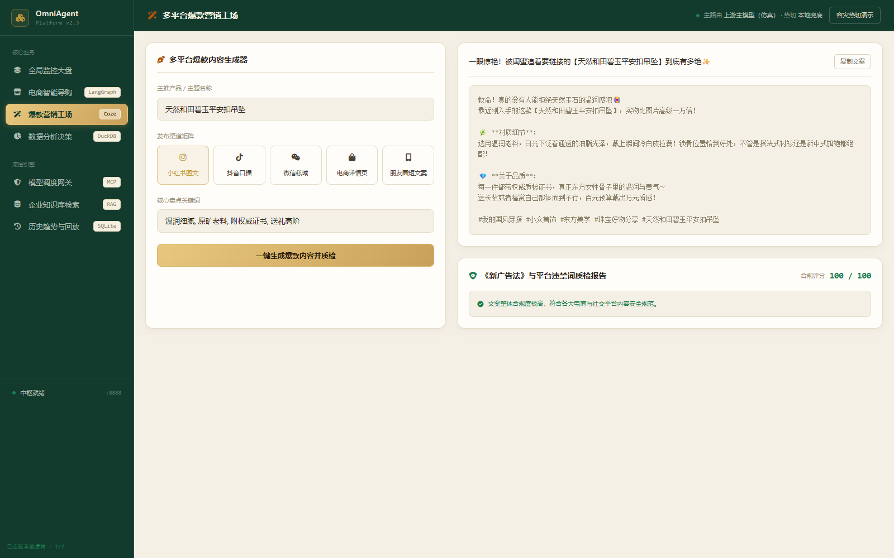
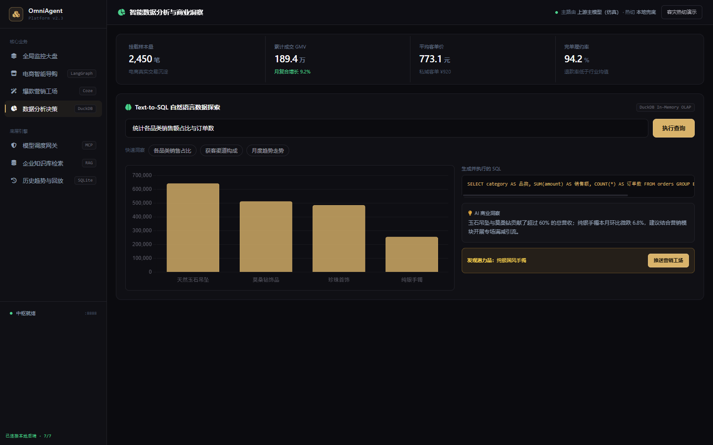
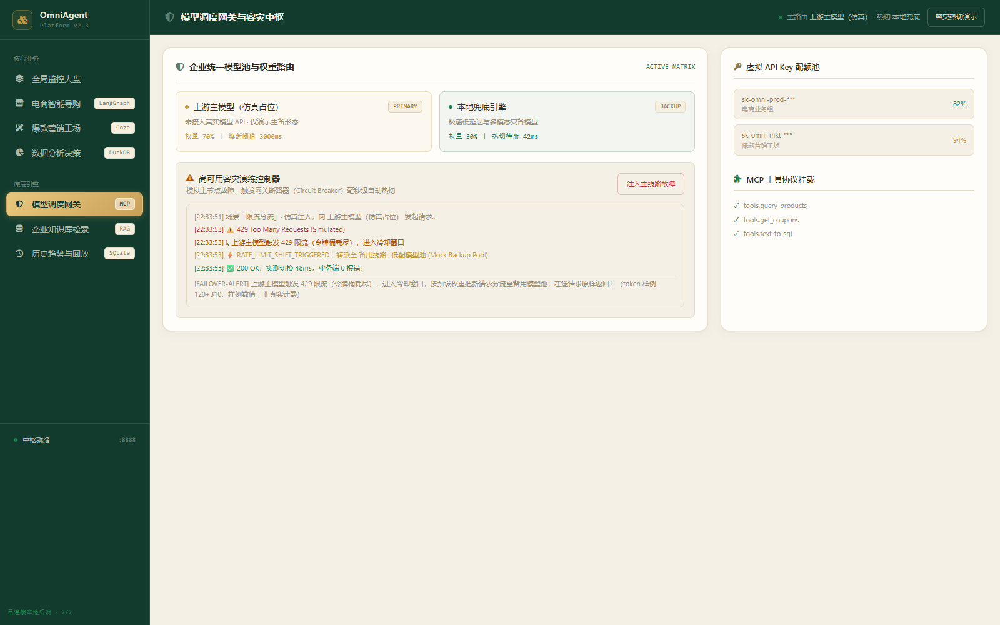
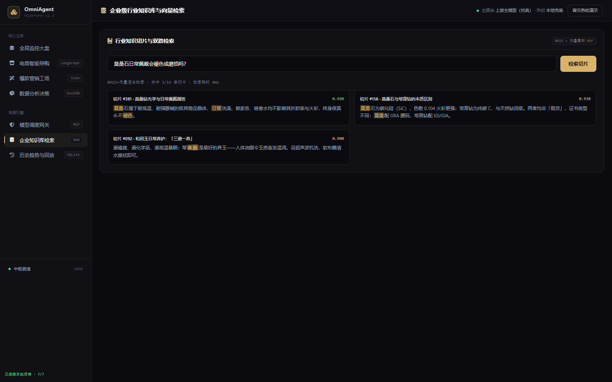
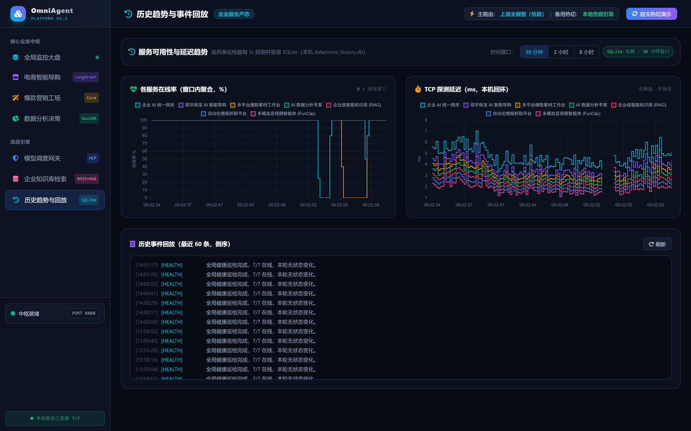

# OmniAgent Platform 2.8 · 企业级全域 AI 智能体控制中枢 (Global DTC E-Commerce & Content Studio)

把 **8 个各自独立的 AI 微服务**，收进一个统一控制台 —— 一个页面看清整个 Agent 集群的拓扑、在线状态与业务闭环。
已全面升级为 **企业生产级架构**：多角色视窗、爆款实效归因抽屉、core/routers 微内核分层解耦、HMAC-SHA256 JWT 多租户鉴权、4-Tier RBAC 敏感守卫拦截，以及后台分布式异步任务队列。


[](https://github.com/YuHeng-123/OmniAgent-Platform/actions/workflows/ci.yml)
[](https://yuheng-123.github.io/OmniAgent-Platform/)
<!-- ↑ CI 徽章已激活：每次 push 自动跑 70 项测试 + ruff + docker build。 -->


---

## 🚀 v2.8 企业级生产架构升级 (Enterprise Architecture Evolution)

系统在保持 **100% 离线自包含** 与 **100% 历史契约兼容** 的前提下，完成了一整套现代企业级全栈演进：

```
                                 ┌─────────────────────────────────────────────────────────────┐
                                 │       OmniAgent Platform 2.8 统一控制台 (前端/双模渲染)      │
                                 └──────────────┬───────────────────────────────┬──────────────┘
                                                │                               │
                      [JWT + X-Tenant-ID Header]▼                               ▼ [WebSocket / SSE]
                                 ┌─────────────────────────────────────────────────────────────┐
                                 │                FastAPI 微内核装配层 (server.py)             │
                                 │         trace_id_middleware / tenant_context / CORS        │
                                 └──────────────┬───────────────────────────────┬──────────────┘
                                                │                               │
                   ┌────────────────────────────┴─────────────┐   ┌─────────────┴────────────────────────────┐
                   ▼                                          ▼   ▼                                          ▼
       ┌────────────────────────┐                 ┌───────────────────────┐                     ┌────────────────────────┐
       │   routers/ 业务路由分层 │                 │ core/security.py 守卫 │                     │ core/tasks.py 异步状态机│
       ├────────────────────────┤                 ├───────────────────────┤                     ├────────────────────────┤
       │ • system (探针/服务管控) │ ──────────────▶ │ • HMAC-SHA256 JWT 签发│                     │ • 状态机 PENDING ➔     │
       │ • events (SSE 差异推送) │                 │ • 多租户隔离 (tenant) │                     │   RUNNING ➔ COMPLETED  │
       │ • gateway (容灾热切仿真)│                 │ • RBAC 4-Tier 权限矩阵│                     │ • FunClip 长视频切片   │
       │ • business (导购/营销)  │                 │ • 敏感操作 403 强拦截 │ ◀───────────────────┤ • 出海社媒批量批处理   │
       │ • labs (深度工场状态机) │                 └───────────────────────┘                     └────────────────────────┘
       └────────────────────────┘
```

### 1. 👑 多角色动态视窗 (Persona Views)
总览页顶部提供 4 大专业角色视窗，一键过滤大盘视图，赋能跨岗位业务协同：
- **👑 经营决策大盘**：只聚焦 GMV、ROAS、漏斗转化、核心爆款与投资回报率 ROI。
- **⚡ 出海运营工场**：聚焦多语言出海社媒文案生成流水线、实时短视频切片工位与 HITL 状态。
- **🛠️ 架构运维拓扑**：聚焦 2.5D 力导向 HUD、端口在线率探测、毫秒级延迟曲线与事件总线。
- **🌐 全域调度总览**：全量微服务集群监控、服务起停管控与状态一览。

### 2. 💎 爆款 SKU 深度实效归因抽屉 (Interactive SKU Attribution Drawer)
点击商品卡片（如莫桑石钻戒 / 翡翠吊坠），右侧滑出全维度分析抽屉：
- **转化漏斗与 ROAS 归因**：曝光量 ➔ 详情页点击 ➔ 加购 ➔ 成交，ROAS 3.82 商业归因。
- **Prompt 演进与 A/B 测试**：V1.0 通用词 ➔ V2.1 奢品光影 ➔ V3.0 出海场景转化词多代对比，实效提升 +75%。
- **短视频 15s 完播留存曲线**：前 3 秒黄金抓手、7 秒卖点翻转、12 秒行动号召完播率分析。
- **实操闭环**：导出实效 JSON 报告、同步导购知识库、一键派生 3 套新变体。

### 3. 🏗️ 后端模块化分层解耦 (Monolith to Modular Microkernel)
将原本 2,470 行庞大的单体 `server.py` 平滑无损拆解为符合领域驱动（DDD）规范的工程体系：
- **`core/config.py`**：统一常量、配置读取与拓扑容灾回退；
- **`core/models.py`**：Pydantic 请求体契约校验；
- **`core/state.py`**：探针轮询、熔断器计数与系统遥测状态；
- **`core/process.py`**：子进程启停安全管理与 PID 表维护；
- **`core/templates.py`**：模板加载器与上下文构建器；
- **`core/security.py`**：自包含 HMAC-SHA256 JWT Token 签发与 RBAC 权限矩阵校验；
- **`core/tasks.py`**：支持多租户与带锁状态机管理的后台异步任务中心；
- **`routers/`**：`system.py`、`events.py`、`gateway.py`、`business.py`、`labs.py`；
- **`server.py`**：精简为 200 行清晰的微内核装配器，对外保持 100% 接口与契约兼容。

### 4. 🛡️ 企业级多租户与 4-Tier RBAC 敏感操作守卫
- **自包含 HMAC-SHA256 JWT**：自动签发与验签，支持 `tenant-hq` (北美独立站旗舰), `tenant-tiktok` (TikTok Shop 全球矩阵), `tenant-embroidery` (Instagram 欧美轻奢独立站) 多租户隔离；
- **4-Tier RBAC 角色矩阵**：Admin (系统总管), Operator (运营专家), Analyst (数据分析师), Auditor (合规审计员)；
- **服务端 403 权限守卫**：敏感操作（如启停微服务）在服务端严格守卫，只读角色尝试操作时直接返回标准 HTTP 403 `PERMISSION_DENIED`，前端展示高风险告警。

### 5. ⚡ 分布式异步任务队列与状态机抽屉 (Distributed Task Center)
- **解耦长耗时操作**：视频切片（FunClip）与出海多语言批量文案生成接入后台任务队列，避免阻塞 Web 网关；
- **任务状态机**：严格流转 `PENDING` ➔ `RUNNING` ➔ `COMPLETED` / `FAILED`，支持多租户查询与重试；
- **前端任务中心抽屉**：顶栏灵动岛在途任务实时徽章，右滑出任务中心监控状态、进度条与执行耗时，支持 4 秒轮询与快速派发。

---

## 界面预览

> 界面主题全新升级为「**曜石深空 × 霓虹翡翠 · Obsidian Cyber-Emerald**」：深邃暗夜黑底 (`#0B0F19`) + 霓虹翡翠绿 (`#10B981`) + 量子青 (`#06B6D4`) + 纳米级磨砂毛玻璃卡片与精密呼吸微动效，专为次世代全域 AI 智能体控制中枢打造。
> 以下截图全部来自本机真实运行 —— 控制台起在 `:8899`，8 个业务端口用仓库自带的
> `tools/mock_service.py` 占位，浏览器实际操作后截取，非设计稿。

**总览 · 全域智能体调度大盘**
7/7 在线，每张卡片带真实的起停按钮；右侧「中枢事件总线」由真 TCP 探测的差异驱动。


**垂直电商 AI 智能导购**
真发一条需求，右侧 LangGraph 推理时序逐步 `DONE`；底部如实标注本次应答来源（上游 `:8001` 未起时降级为本地兜底）。


**爆款营销工场 · 多平台文案 + 违禁词质检**
选渠道、填卖点，一键生成文案，并逐条给出《广告法》违禁词检出与合规改写建议。



**数据分析决策 · Text-to-SQL**
自然语言 → SQL → 动态图表 → 经营结论，并自动标注「发现潜力品」以便一键转营销。



**模型调度网关与容灾中枢**
点「注入主链路宕机故障」后：上游超时 / 限流 → 自动热切备用链路，全程业务无感。



**企业知识库检索 · RAG**
BM25 + 向量混合检索，命中切片带置信度与关键词高亮。



**历史趋势与事件回放**
数据落 SQLite（24h 保留）。在线率曲线中段那道坑，就是一次真实的「某服务下线 → 后被重新拉起」。



**移动端 · 窄屏抽屉导航**
窗口窄于 1024px 时侧栏自动收起为抽屉，手机也能完整操作。


---

## 60 秒看懂

控制台就 7 个页面，每个页面都能真的点、真的出结果：

| 页面 | 它演示什么 |
|---|---|
| 总览 | 8 个微服务的实时在线状态 + 4 大角色动态视窗 (Persona Views) + 爆款 SKU 实效归因抽屉 + 后台任务中心 + 真实 TCP 探测事件总线 |
| 导购 | 垂直轻奢电商独立站 AI 智能导购：优先真连 `:8001` 并解析它的 SSE 流，连不上才降级；8 类意图 + 商品池自动配品 |
| 营销 | Shopify / TikTok Shop / Instagram / Meta Ads / Pinterest / YouTube Shorts 六渠道文案生成 + 全球广告合规风控质检 |
| 分析 | 自然语言 → Text-to-SQL (DuckDB) → 动态图表 → 商业经营结论（8 类问法与潜力爆品挖掘） |
| 网关 | 主备毫秒级热切仿真（响应自带 `simulated: true`）；三场景轮换（超时熔断 / 限流分流 / 质量降级重生成） |
| 知识库 | BM25 + 向量混合检索 (RAG)，命中切片带置信度与高亮标注 |
| 历史 | 在线率 / 延迟曲线（SQLite 落盘，24h 保留）与事件时序回放 |
| 工场 | Instagram & TikTok 出海工场 · LangGraph 1.0 (HITL 人在环路状态机审批与海报生成) |
| 切片 | 达摩院 FunClip 多模态音视频智能切片（带锁异步任务队列后台执行） |

**它是什么**：一套「Agent 集群编排」的可运行演示 —— 拓扑配置化、前后端真接口、断网自动降级、有断言测试、有 CI。
**它不是什么**：8 个微服务里 6 个的运行时不在本仓库（源码收编的 2 个见 Labs 章节）；页面里的经营数据是**构造的样例数据**（接口 `metrics_source: demo-sample` 如实标注）。

## 三种打开方式（都是真的能跑）

| 场景 | 怎么跑 | 说明 |
|---|---|---|
| 🌐 **在线演示 · 零后端** | **[已上线 → yuheng-123.github.io/OmniAgent-Platform](https://yuheng-123.github.io/OmniAgent-Platform/)** | 纯静态、依赖全本地化，**断网也能渲染**；数据来自内置降级层，页面顶栏会明确标注「静态演示模式」。离线场景可双击本地 `docs/index.html` |
| 💻 **本地全功能** | `run.bat`（Windows）/ `./run.sh`（macOS·Linux） | 真后端、真接口、真耗时；8 个服务在线时亮绿点并实时数出来 |
| 🐳 **容器里跑** | `docker compose up --build` | 控制台镜像化（python-slim · 非 root · 带 healthcheck），历史库落命名卷 |

### 本地一键启动

```bash
# Windows
run.bat

# macOS / Linux
chmod +x run.sh && ./run.sh
```

首次运行会自动建 `.venv` 并装依赖，然后启动在 <http://127.0.0.1:8888>。
健康检查：<http://127.0.0.1:8888/healthz>（版本 / 运行时长 / 拓扑来源 / 实时在线数）。

手动方式：

```bash
python -m venv .venv
.venv/Scripts/python -m pip install -r requirements.txt   # Windows
python server.py
```

端口可换：`OMNI_PORT=8899 python server.py`（默认 8888）。

### Docker 一键启动

```bash
docker compose up --build      # 控制台起在 http://127.0.0.1:8888
```

容器化有两个**必须**设置的网络变量，镜像里已经写好，原因值得记一下：

| 变量 | 容器里的值 | 为什么 |
|---|---|---|
| `OMNI_HOST` | `0.0.0.0` | 进程若只 bind `127.0.0.1`，Docker 的端口发布（`-p 8888:8888`）是把宿主机端口 DNAT 到容器 eth0，**从宿主机根本打不通**；更坑的是容器自带 healthcheck 从 loopback 打是通的，于是变成「显示健康、实际访问不了」的静默失败 |
| `OMNI_PROBE_HOST` | `host.docker.internal` | 容器内的 `127.0.0.1` 是容器自己，探不到跑在宿主机上的 8 个微服务 —— 不设这个，面板恒显示 0/8 |

> **边界说明**：「起停按钮」在容器里只对**容器内**的进程有效（容器看不到宿主机的进程表）。要演示停服→下线事件，请用本地方式跑，或让微服务也一起容器化进同一网络。

### 部署到 GitHub Pages

`docs/` 目录是**自包含**的（HTML + `static/vendor/` 全部前端库都在里面），可直接作为发布目录：

1. 把仓库推到 GitHub
2. **Settings → Pages → Source: Deploy from a branch → Branch: `main` / 目录: `/docs`**
3. 访问 `https://YuHeng-123.github.io/OmniAgent-Platform/`

> `docs/` 由 `build_docs.py` 生成，**不要手改**。改了 `templates/index.html` 或 `static/` 之后重跑：
> ```bash
> .venv/Scripts/python build_docs.py
> ```

---

## 8 个微服务矩阵

控制台本身不包含业务逻辑，它编排的是下面这些独立项目（各自一个仓库 / 一个端口）：

| 端口 | 服务 | 角色 | 技术栈 |
|---|---|---|---|
| 8000 | 企业 AI 统一网关 | 流量总线与大模型调度 | FastAPI + Redis + MCP |
| 8001 | 垂直独立站 AI 智能导购 | 核心业务 Agent | LangGraph + SQLite + SSE |
| 8002 | 全球 DTC 爆款素材工作台 | 内容营销 Agent | Coze API + FastAPI |
| 8501 | 企业级智能知识库 (RAG) | 知识底座 | Streamlit + ChromaDB |
| 8510 | AI 商业数据分析专家 | 决策分析 Agent | Streamlit + DuckDB + Plotly |
| 8765 | 全球竞品情报抓取平台 | 数据管道 | Python Native HTTP + SQLite |
| 7860 | 多模态音视频智能体 (FunClip) | 交互 Agent | Gradio + PyTorch + FunASR |
| 8020 | 出海社媒内容工场 (Labs) | 内容营销 Agent | LangGraph 1.0 + Postgres Checkpointer + Vue3 |

**控制台不依赖这 8 个服务是否在线** —— 在线就亮绿点，不在线就灰色，控制台自身照常可用。

---

## Labs · 收编进中枢的纵深模块（v2.6 收编 · v2.7 注册为探针服务）

控制台是广度，Labs 是深度。两个支撑业务纵深的具体实现，从独立项目收编进仓库，
并作为**一等公民注册进服务矩阵**：`:8020` 是出海社媒营销工场的专属探针端口，
`:7860` 就是 funclip-studio —— 总览页拓扑里直接亮灯，`/api/v1/labs` 提供模块索引（README 摘要 + 亮点 + 状态）。

| 模块 | 一句话 | 亮点 |
|---|---|---|
| [labs/graph-xiaohongshu](labs/graph-xiaohongshu/) | LangGraph 1.0+ Instagram & TikTok 出海社媒流水线（即 8 服务中的 `:8020`） | `StateGraph` + subgraph 图编排 · `interrupt()` + `Command(resume)` 标准人在环路（选题 / 审稿两道人工闸门，驳回带反馈重写）· AsyncPostgresSaver 状态持久化 · 日志出口 PII 脱敏 · 双模型分级调度 · JWT 认证 + Vue 3 前端 |
| [labs/funclip-studio](labs/funclip-studio/) | FunClip 的 Windows 工程化封装（即 8 服务中的 `:7860`） | 上游为阿里达摩院 FunClip（MIT，LICENSE 与双语 README 原样保留署名）；本仓作者封装一键启停（端口探测 / 日志重定向 / 就绪轮询）与**不加载模型**的 ASR 结果兼容性单测 |

> 边界（如实说明）：CI 与 Docker 均不包含 labs —— 两个模块各带重依赖
> （langgraph / PostgreSQL、funasr / torch），控制台不装、不跑、不假装跑，
> 详见 [labs/README.md](labs/README.md)。graph-xiaohongshu 的 `.env` 含真实 Key，
> 收编前已清洗为 `.env.example` 占位。

---

## 核心设计：双模式数据源

前端所有取数走 `static/omni-api.js` 这一层适配器：

```
                 ┌─── 成功 → 用真实数据（顶栏:「本地服务已连接 N/8」）
请求本地后端 ────┤
  (2.5s 超时)    └─── 失败 → 降级到内置演示逻辑（顶栏:「静态演示模式」）
```

**先试真的，真不了才用假的，且当前模式始终显示在页面上** —— 不把演示数据伪装成线上数据。

导购链路的降级更细一层（`server.py`）：

```
POST /api/v1/guide/chat
   ├─ 优先真调 ecom-agent(8001)，解析其 SSE 事件流
   │     └─ 拿到 token → 返回 backend="live:ecom-agent@8001"
   └─ 8001 不可用 / 上游 4xx / 流里没有正文
         └─ 降级到本地规则引擎 → backend="fallback:local-demo"
```
响应里永远带 `backend` 字段，你一眼能看出这次回答是真跑的还是兜底的。

---

## 核心设计：中枢事件总线（真实探测驱动，不是滚动的假日志）

总览页右下角那条事件流，**不是把几行日志写死在前端滚动**，而是一条真 SSE 流：

```
GET /api/v1/events/stream   (text/event-stream)
   ├─ 打开即推：1 条接入说明 + 8 条服务就绪播报（基于真实 TCP 探测结果）
   ├─ 之后每 3s 重新探测 8 个端口，与上一轮快照比对
   │     ├─ 有变化 → 立刻推「上线 / 下线」事件
   │     └─ 无变化 → 每第 4 轮推一条巡检心跳（避免刷屏）
   └─ 客户端断开即回收（request.is_disconnected）
```

拿不到后端（GitHub Pages / `file://` / 服务未启）时，前端 `omni-api.js` 自动降级为内置示例事件，
右上角角标从 `LIVE · 真实端口探测` 变成 `示例事件流 · 无后端` —— 不冒充实时。

**这条链路有独立验证脚本**（不靠自夸，靠注入式端口探测做端到端验证）：

```bash
.venv/Scripts/python verify_event_bus.py     # → evidence/event-bus-diff.txt
```

它把底层 `scan_ports` 做注入：第 1 轮取真实探测结果，第 2 轮起把 `:7860` 的在线状态**翻转**，
然后断言流里**确实出现了一条由差异触发的状态变化事件**。

> 为什么是「翻转」而不是「置为离线」：脚本必须和运行环境无关 ——
> 你机器上 7 个服务开着，就翻成下线（验下线事件）；一个都没起，就翻成上线（验上线事件）。
> 两个方向都能证明事件是差异驱动的。**这个坑是实测踩出来的**：原来的写法硬编码「置为离线」，
> 在一台 7 个服务全没起的机器上会永远等不到变化，把好好的代码验成 FAIL。

实测输出（那一次本机 7 个服务都没起，所以注入方向是「上线」）：

```
T+ 0.4s  [MASTER  ] (info) 事件总线接入成功：…当前在线 0/7
T+ 0.4s  [FUNCLIP ] (warn) 多模态音视频智能体 (FunClip)（:7860）未响应，标记为离线。
T+ 3.8s  [HEALTH  ] (ok)   多模态音视频智能体 (FunClip)（:7860）状态变化：上线，已重新纳入调度。
T+13.9s  [HEALTH  ] (info) 全局健康巡检完成，0/7 在线，本轮无状态变化。
结论: PASS —— 事件确实由状态差异驱动，非定时文本播报
```

> **现场演示怎么用**：把任意一个服务停掉（例如 `:7860`），**3 秒内**右侧面板就会出现一条红色的下线事件；
> 再启动它，3 秒内出现绿色的上线事件。比任何形容词都有说服力。

---

## 1.0 → 2.8 改了什么（每条都有实测）

| # | 过去的问题 | 现在的做法 |
|---|---|---|
| 1 | 导购接口接了 8001 却 `pass` 丢弃结果，页面回的是写死的套话 | 真解析 SSE 流；失败才降级，且 `backend` 如实标注 |
| 2 | `latency_ms` 是写死的常数（38 / 22 / 42） | 全部 `time.perf_counter()` 实测；前端拿不到就显示 `—`，不预设假数 |
| 3 | 前端 4 个 CDN（tailwind / fontawesome / chart.js / Google Fonts），断网即白屏 | 全部本地化到 `static/vendor/`，改系统字体栈，**零外部请求** |
| 4 | 假模型名 `Gemini-3.8-Flash` | 移除编造模型名（pytest 里有断言防回归） |
| 5 | 同步 socket 探测端口阻塞 async 事件循环 | `asyncio.open_connection` + `asyncio.gather` 并发探测 |
| 6 | CORS `allow_origins=["*"]` + `credentials=True`（浏览器规范禁止） | `allow_credentials=False` |
| 7 | 只能在本地跑，无法静态演示 | 新增 `docs/` 纯静态版 + `build_docs.py` 构建脚本 |
| 8 | 事件总线是**写死的 6 行文本**（时间戳永远停在 `19:15:02`），标着 LIVE 却永不刷新 | 改为真 SSE 差异驱动流（见上一节）；降级时角标明确写「示例事件流」 |
| 9 | 7 个服务的端口/名称/事件标签硬编码在 `server.py`，加服务得改代码 | 抽到 `services.yaml`；坏配置自动回退内置默认，`/overview/stats` 里的 `config_source` 可直接看出拓扑来自哪 |
| 10 | 没有任何自动化测试，改动靠人肉点页面 | **70 条 pytest 断言**（拓扑 / 事件总线纯函数 / 前端本地化 / API 契约 / labs 契约 / docs 一致性 / 健康检查 / 历史与起停 / JWT 鉴权 / RBAC 守卫 / 异步状态机）+ GitHub Actions CI |
| 11 | `docs/` 是手工产物，容易和源码悄悄脱节 | CI 每次重跑 `build_docs.py` 再 `git diff --exit-code -- docs/` 断言无漂移 |
| 12 | 导购页硬写「驱动模型：DeepSeek-V3 / Flash」、单步耗时预设 `38 ms` | 假模型名删除；耗时改为「实测值，拿不到显示 `—`」；新增**应答来源**直接显示 `live:` / `fallback:` |
| 13 | 冗余脚本 `start.bat`、`start_all_services.py`（指向并不存在的 `:9999`）、3 个 `.bak` | 清理；`start_all_services.py` 换成读 `services.yaml` 的 `check_services.py` 就绪检查 |
| 14 | 编造模型名只清了前端：网关页 3 处 + 仿真端点 2 处仍写着 `DeepSeek-V3`，防回归断言也只扫 2 个文件 | 全部改为「上游主模型（仿真占位）」；断言扩到 5 个交付代码文件（连注释里的历史对照都不放行） |
| 15 | 导购链路硬编码 `8001`，改 yaml 端口后代码不跟着变 | 端口/路径改从拓扑读取（`GUIDE_PORT` / `GUIDE_CHAT_PATH`），换上游只改配置 |
| 16 | 缺工程标准件：favicon 404、无 `/healthz`、404 返回裸 JSON、版本号三处各写各的、无 LICENSE/CHANGELOG | 补齐：`static/favicon.svg`、`GET /healthz`、带提示的统一 404（Pages 侧配 `docs/404.html`）、`APP_VERSION` 单一来源、MIT LICENSE + CHANGELOG + .editorconfig |
| 17 | 演示「停掉一个服务 → 3 秒内弹下线事件」得手动去命令行杀进程 | 服务卡片上的**起停按钮** + `POST /services/{id}/stop\|start`；`stop` 只杀监听在配置端口上的进程，`start` 没配 `start_cmd` 就如实返回 `not-configured` |
| 18 | 面板只有「此刻」的快照，没有任何历史 | SQLite 落盘 + `GET /api/v1/history/probes`（在线率 / 平均延迟曲线）与 `/events/recent`（事件回放），新增**历史趋势**页签 |
| 19 | 每个 SSE 连接各自跑一套端口探测，开 3 个页面就探 3 遍 | 重构为**全局共享巡检器**（lifespan 内一个 asyncio 任务）：只探测一次，事件统一 diff 后广播给所有订阅者 |
| 20 | `zip()` 没有 `strict=`，探测结果与端口错位会静默截断 | 全部补 `strict=True`，错位立即抛错 |
| 21 | 容器化只是「写了文件」：`uvicorn.run(host="127.0.0.1")` 写死 → 端口发布打不通却显示健康；探测写死 `127.0.0.1` → 容器里恒显示 0/7；`./data` 绑定挂载碰到非 root 写权限 | 新增 `OMNI_HOST` / `OMNI_PROBE_HOST` 两个可配置项（本机默认不变，仍是回环）；改用命名卷；pytest 加 7 条断言锁死这两处，`/healthz` 暴露 `networking` 便于排障 |
| 22 | 单体大泥球 2,470 行 `server.py` 难以维护与扩展 | **领域分层解耦**：拆分为 `core/` 与 `routers/`，微内核装配器精简至 200 行，100% 保持历史契约兼容 |
| 23 | 缺乏企业多租户数据隔离与权限守卫 | **企业安全准入**：自包含 HMAC-SHA256 JWT Token 签发、多租户上下文隔离 (`X-Tenant-ID`)、4-Tier RBAC 敏感守卫服务端拦截 (HTTP 403 `PERMISSION_DENIED`) |
| 24 | 长耗时音视频切片与批量文案阻塞 Web 网关 | **后台分布式异步任务队列**：带锁状态机（`PENDING` ➔ `RUNNING` ➔ `COMPLETED` / `FAILED`），顶栏在途徽章与右滑状态机抽屉 |
| 25 | 大盘视角单一缺乏零售商业深度 | **4 大角色动态视窗 (Persona Views)** + **爆款 SKU 深度实效归因抽屉**（转化漏斗、ROAS、Prompt 演进对比、15s 完播曲线、派生变体闭环） |

---

## 测试与 CI

静态检查 + 五层验证，每一项都能在本地一条命令跑完：

| 项 | 命令 | 验什么 |
|---|---|---|
| ⓪ 静态检查 | `.venv/Scripts/python -m ruff check . && .venv/Scripts/python -m ruff format --check .` | **两条都要过**——CI 跑的就是这两条。只跑 `check` 不跑 `format --check` 会「本地全绿、CI 红」（本项目真实踩过：`format --check` 挂掉后 pytest / 审计 / docker build 全被 skip） |
| ① 断言测试 | `.venv/Scripts/python -m pytest -q` | 拓扑加载与坏配置回退 · 事件总线纯函数 · 前端 0 外部 CDN · docs 与源码一致 · API 响应契约 · `/healthz` · 编造模型名全文件扫描 · SSE 首帧 · 历史/起停接口契约 · **起停端到端** · **多租户 JWT 鉴权** · **RBAC 403 服务端守卫** · **异步任务状态机流转** |
| ② 全链路自检 | `.venv/Scripts/python selftest_omni.py` | 同进程起 API + 起静态站，打 **11 组真实 HTTP**，结果落 `evidence/selftest-omni.txt` |
| ③ 事件总线专项 | `.venv/Scripts/python verify_event_bus.py` | 注入式端口探测，断言「停掉一个服务 → 流里真的出现下线事件」 |
| ④ 前端接线审计 | `.venv/Scripts/python tools/audit_frontend_wiring.py` | 静态分析：`onclick` 是否有实现、`OmniAPI.xxx` 是否真的存在、`getElementById` 是否有悬空 id —— 抓「按钮点了没反应」 |
| ⑤ 运行时端到端 | `.venv/Scripts/python tools/audit_runtime.py` | 起真服务：真拉起一个假监听进程 → 同一条 SSE 流上等「上线」→ 点 stop → 等「下线」→ 校验历史落盘（**自己拉的进程自己杀，不碰你正在跑的服务**） |

CI（`.github/workflows/ci.yml`）在每次 push / PR 上跑：**ruff check + ruff format --check** → pytest → 前端接线审计 → 全链路自检 → 事件总线专项验证 → **重跑 `build_docs.py` 并断言 `docs/` 无漂移** → 构建 Docker 镜像 → 上传 evidence 为 artifact。

> v2.6 起：`labs/` 收编模块不参与以上任何一步（`pytest.ini` 排除收集、`ruff.toml` 排除 lint、`.dockerignore` 不打包）—— 各模块重依赖独立管理，控制台不为它们背书。

> 第 ⑤ 层（运行时端到端）**故意不进 CI**：它会 spawn 进程、耗时约 40 秒、强依赖本机端口环境。
> 它是给「我要亲手确认一遍」用的，不必每次提交都跑。`docs/` 漂移检查则是刻意的：
> 静态演示版一旦和源码脱节，线上看到的就不是这份代码的行为。

> 一个实测出来的坑：pytest 里**不能**用 `TestClient` 去读 SSE —— 本机实测 Starlette 的 TestClient 读到无限流会一直阻塞不返回。
> 所以事件总线这块拆成两种测法：`build_initial_events` / `diff_events` 抽成纯函数直接断言；端到端则真起一个 uvicorn 线程（见 `tests/conftest.py`）。

第 ② 层覆盖：主控台渲染 · 0 外部 CDN · 8 服务在线数 · 导购降级链路 · 自纠错链路 · 合规质检命中违禁词 · Text-to-SQL · 热切仿真 · docs 静态资源全部 200 · 静态化自检 · **SSE 事件总线首帧 9 条真实事件**。

---

## 现场演示：让「停服 → 3 秒内弹下线事件」真的跑起来

这是全项目最有说服力的一个互动点。但 8 个微服务里 6 个的运行时不在本仓库里 —— 不起它们时面板上对应卡片全灰，
按钮没有对象可按。仓库自带一个**明确标注为假**的监听工具专门解决这个：

```bash
# 1. 起控制台
run.bat                                   # 或 ./run.sh

# 2. 另开一个终端，用假监听占住 8002（素材工作台）
.venv/Scripts/python tools/mock_service.py 8002

# 3. 打开 http://127.0.0.1:8888 → 总览页「多平台爆款素材工作台」亮起绿点
#    点那张卡片的「停止」→ 约 3 秒后右侧事件总线推出红色「状态变化：下线」
#    再点「启动」→ 约 3 秒后推出绿色上线事件
```

> `tools/mock_service.py` 是个**真的 TCP 监听**（所以面板上的「端口在线」是真探测出来的），
> 但它**不是业务服务** —— `/` 会如实返回 `{"mock": true}`。它存在的唯一目的，是让
> 探测 → 状态翻转 → 差异事件广播 → 事件回放 这条链路可以完整演示一遍。

想让「启动」按钮也能用（不必每次手动起监听），在 `services.yaml` 里给服务加上一行：

```yaml
start_cmd: ["python", "tools/mock_service.py", "8002", "--id", "coze-material-studio"]
```

`services.yaml` 里已经留了注释好的这一行，取消注释即可。没配 `start_cmd` 的服务，
「启动」按钮会如实返回 `not-configured` —— 控制台不假装知道你没告诉过它的启动方式。

---

## 诚实边界

这个仓库是我（作者）用来**演示 Agent 集群编排形态**的控制台，以下几点如实说明：

- **控制台的业务数据是演示数据。** 营销文案、SQL 结果、GMV 数字、热切延迟，都是本地生成的样例，不是某家公司的真实经营数据。
- **网关 `:8000` 没有接真实的大模型 API。** 所以导购链路里凡标注 `backend: "fallback:local-demo"` 的回答，都是**本地规则引擎**按关键词拼出来的文本，不是模型生成的；响应里的 `model` 字段会如实写成「本地规则引擎（离线降级）」，不冒充某个模型名。
- **页面里不存在编造的模型名。** 1.0 曾在导购页硬写 `Gemini-3.8-Flash`，2.0 已移除，并且 pytest 里有一条断言专门防止它回归。
- **「停止」按钮会真的杀进程。** 它终止的是**监听在 `services.yaml` 配置端口上**的进程 —— 端口表之外的 PID 一律不碰，但配置内的会真停。演示前请确认那些进程停得起。
- **「启动」按钮只认 `start_cmd`。** 没在 `services.yaml` 里配置启动命令的服务，点了会如实返回 `not-configured` 并提示怎么配 —— 控制台不假装知道你没告诉过它的启动方式。
- **历史曲线是从控制台启动那一刻才开始记的。** 数据落在本地 SQLite（`data/omni_history.db`，不入 git），保留 24 小时；换个机器/清掉目录就是空的，静态演示模式下显示的是内置样例曲线而非真实历史。
- **`/api/v1/gateway/simulate_failover` 是仿真端点**，它不真的去熔断某个上游，只演示「主备热切」这个形态；响应里自带 `"simulated": true`，主路由名一律写「上游主模型（仿真占位）」—— 2.1 之前这里曾残留编造的模型名 `DeepSeek-V3`（已清除并有断言防回归），token 数值也标注了 `token_usage_note: 样例数值，非真实计费`。
- **8 个微服务里 6 个是独立项目**（运行时不在本仓库内）；funclip-studio 与 graph-xiaohongshu 的**源码**已收编进 `labs/`（`:7860` / `:8020`），但运行时同样需要各自起。本仓库是控制台 + 编排层 + Labs 源码。想看真实链路，需要各自把服务起起来。
- **端口探测的目标地址是 `PROBE_HOST`**（默认 `127.0.0.1`，容器里指 `host.docker.internal`），不做远程服务发现 —— 它探的是「本机/宿主」这一台。
- **容器镜像在本机没有构建过。** 作者的环境没装 Docker CLI，所以 `Dockerfile` / `docker-compose.yml` 未经 `docker build` 验证；CI 里那条 `docker build` 步骤也要等仓库推上去才会真正执行。其中**最容易踩的两个坑已在代码层修掉并有断言锁定**（监听地址、探测地址、非 root 写权限），但「镜像能不能 build 成功」这一条仍属未验证。
- **事件总线的心跳是 12s 一次**（3s 探测 × 4 轮），只有状态**变化**才实时推送 —— 这是刻意压掉刷屏，不是采样不到。
- **已原生落地 HMAC-SHA256 JWT 多租户鉴权与 RBAC 4-Tier 角色矩阵守卫**：支持 `tenant-hq` / `tenant-tiktok` / `tenant-embroidery` 多租户数据隔离，敏感操作（起停微服务）在服务端严格进行角色校验与 HTTP 403 拦截，并接入后台异步任务状态机队列。业务数据与模型推理仍然遵守严谨的真实/样例标注规范，不冒充线上闭源大模型。

---

## 目录结构

```
OmniAgent-Platform/
├─ server.py              # FastAPI 微内核装配层（路由聚合、CORS、trace_id 与租户上下文中间件、启动入口）
├─ core/                  # ★ 核心领域层（解耦自原本 2,470 行单体 server.py）
│  ├─ config.py           # 统一配置、常量、版本单一来源 APP_VERSION 与 services.yaml 解析
│  ├─ models.py           # Pydantic 契约模型
│  ├─ state.py            # 全局探测状态、熔断器、系统遥测缓存
│  ├─ process.py          # 子进程管理与安全启停管控
│  ├─ templates.py        # Jinja2 模板加载与上下文组装
│  ├─ security.py         # 自包含 HMAC-SHA256 JWT 签发/解码与 RBAC 403 权限守卫
│  └─ tasks.py            # 分布式异步任务队列与状态机（PENDING ➔ RUNNING ➔ COMPLETED）
├─ routers/               # ★ 业务路由分层模块
│  ├─ system.py           # 探针/服务管控/JWT Token 签发/任务中心 API
│  ├─ events.py           # SSE 差异驱动实时事件总线
│  ├─ gateway.py          # 网关容灾热切仿真与 Trace 审计
│  ├─ business.py         # 智能导购 (LangGraph) / 营销工场 / 数据分析 (DuckDB) / RAG 检索
│  └─ labs.py             # 达摩院 FunClip 视频切片与出海社媒工场异步状态机接口
├─ services.yaml          # ★ 唯一拓扑来源：端口/名称/事件标签/探测参数/导购路径/start_cmd，加服务只改这里
├─ check_services.py      # 就绪检查：读 services.yaml，逐个 TCP 探测并打印在线表
├─ build_docs.py          # 生成 docs/ 静态演示版（复用 server.py 拓扑与版本号，单一来源）
├─ selftest_omni.py       # 11 组离线自检 → evidence/
├─ verify_event_bus.py    # 事件总线「差异驱动」专项验证 → evidence/
├─ tests/
│  ├─ conftest.py         # 真 uvicorn 线程 fixture（不用会阻塞的 TestClient）
│  ├─ test_omni.py        # 66 条断言：拓扑/事件总线/前端本地化/API 契约/labs/健康检查/历史与起停
│  └─ test_enterprise_security_and_tasks.py # ★ 企业级 JWT 鉴权、RBAC 403 拦截与异步任务流转测试
├─ requirements.txt       # 运行依赖（+ psutil：服务起停用）
├─ requirements-dev.txt   # + pytest / ruff / pre-commit
├─ run.bat / run.sh       # 一键启动（自动建 venv 装依赖）
├─ Dockerfile             # 控制台镜像（python-slim + 非 root + healthcheck）
├─ docker-compose.yml     # 一键起控制台，数据卷持久化历史库
├─ .dockerignore
├─ ruff.toml              # lint 规则
├─ .pre-commit-config.yaml
├─ .github/workflows/ci.yml
├─ assets/architecture.svg
├─ assets/screenshots/    # README 用的真机截图（本机实跑后截取）
├─ LICENSE                # MIT
├─ CHANGELOG.md           # 完整变更记录（含 2.8 企业级全栈升级）
├─ .editorconfig
├─ data/                  # 运行时产物（不入 git）：omni_history.db —— 历史曲线与事件回放的落盘库
├─ templates/
│  ├─ index.html          # 主控台页面（Jinja2 模板；含角色视窗、SKU 抽屉、任务中心抽屉）
│  └─ partials/           # 模块化子组件（tab_overview, tab_guide, tab_xhs 等）
├─ static/
│  ├─ omni-api.js         # 双模式数据源适配层（JWT 自动注入、异步任务流拉取、真接口 ⇄ 内置降级）
│  ├─ favicon.svg         # 站点图标（渐变立方体，与品牌标识同款）
│  └─ vendor/             # 本地化前端库：tailwind / chart.js / fontawesome
├─ docs/                  # ← GitHub Pages 发布目录（build_docs.py 生成，勿手改）
│  ├─ index.html
│  ├─ 404.html            # Pages 自定义 404（带返回首页链接）
│  └─ static/…            # 自包含副本（含 favicon）
├─ labs/                  # ★ v2.6 收编的纵深模块源码（不进 CI / 不进镜像）
│  ├─ README.md           # Labs 导航与边界说明
│  ├─ graph-xiaohongshu/  # LangGraph 1.0 出海社媒营销 Agent（探针端口 :8020）
│  └─ funclip-studio/     # FunClip 封装层 + 上游源码（探针端口 :7860）
└─ evidence/
   ├─ selftest-omni.txt   # 全链路实测证据
   └─ event-bus-diff.txt  # 事件总线差异驱动验证证据
```

---

## 常见问题

**页面打开是白板 / 样式丢了？**
1.0 时代是因为依赖外部 CDN。2.0 已全部本地化。若仍异常，检查浏览器控制台是否 404 了 `static/vendor/...`（确认你是从仓库根目录启动，而不是把 `index.html` 单独拷出去）。

**总览页 8 个服务全是灰的？**
正常 —— 说明你只起了控制台，那 8 个服务没起。控制台自身功能不受影响。

**怎么快速知道我的 8 个服务起了没？**
跑 `.venv/Scripts/python check_services.py`，会打一张在线表（读 `services.yaml`，逐个 TCP 探测）；加 `--require-all` 则要求 8/8 全在线才返回 0。

**改了 `services.yaml` 会怎样？**
不用改任何代码，重启控制台即生效。如果 yaml 写坏了（比如某个服务缺 `id` / `port`），控制台不会崩，会自动回退到内置默认拓扑，并在 `/api/v1/overview/stats` 的 `config_source` 字段里注明原因。

**CI 说 `docs/` 不同步、把我的 PR 拦了？**
因为你改了 `templates/index.html` 或 `static/`，但没重跑 `build_docs.py`。本地跑一次 `.venv/Scripts/python build_docs.py` 再提交即可。

**端口 8888 被占用？**
`OMNI_PORT=8899 python server.py`。

**想改页面样式？**
改 `templates/index.html` 或 `static/omni-api.js`，然后重跑 `build_docs.py` 更新静态演示版。
